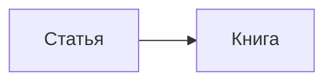

# Установка в Windows

Для нового комплекта MiKTeX используйте Windows 11 x64, Windows PowerShell 5.1 и папку, в которую можно записывать файлы. При первой установке с загрузкой из интернета нужен доступ к источникам WinGet, PyPI и зеркалу MiKTeX. Если вы получили `md-pdf-pipeline-windows-x64-offline.zip`, распакуйте его и перейдите сразу к разделу «На компьютере без интернета». [Требования MiKTeX к системе](https://miktex.org/kb/prerequisites-2-9)

## Установка из архива

1. Откройте свойства полученного ZIP. Если Windows показывает флажок «Разблокировать», установите его для доверенного архива и примените изменение. Распакуйте ZIP, например в `C:\Tools\md-pdf-pipeline`.
2. В Windows PowerShell перейдите в распакованную папку и запустите подготовку окружения. Параметр `-InstallTools` разрешает WinGet установить отсутствующие Python, Pandoc и MiKTeX. Сценарий создаёт `.venv` и устанавливает в него библиотеки из `requirements.txt`. Параметр `-ExecutionPolicy Bypass` действует только на запущенный процесс PowerShell.

   ```powershell
   Set-Location -LiteralPath 'C:\Tools\md-pdf-pipeline'
   powershell.exe -NoProfile -ExecutionPolicy Bypass -File .\setup.ps1 -InstallTools
   ```

3. Запустите сборку встроенного примера. Если с момента установки PowerShell был открыт, а система сообщает, что программа не найдена, откройте новое окно и снова перейдите в папку проекта. При первом запросе MiKTeX разрешите установку недостающего пакета для текущего пользователя.

   ```powershell
   powershell.exe -NoProfile -ExecutionPolicy Bypass -File .\build.ps1 -Source .\examples\guide -Output .\out\guide.pdf -Title "Площадь треугольника"
   ```

4. Откройте `out\guide.pdf`. В нём должны быть русские заголовки, ссылка из введения к статье, чертёж с катетами 3 и 4, дробь в формуле и таблица. Этим примером можно проверить и следующий компьютер после передачи архива.

## Состав установки

| Компонент | Для чего нужен | Официальное скачивание для Windows x64 |
|---|---|---|
| CPython 3.11 или новее | Выполняет сборку. Вариант через WinGet использует Python 3.13. При ручной установке включите `venv` и `pip`. | [Python 3.13.17, EXE](https://www.python.org/ftp/python/3.13.17/python-3.13.17-amd64.exe) |
| Pandoc 3.8.2 или новее | Разбирает Markdown с формулами и таблицами и готовит документ для вёрстки. Lua входит в установщик. | [Pandoc 3.8.2, MSI](https://github.com/jgm/pandoc/releases/download/3.8.2/pandoc-3.8.2-windows-x86_64.msi) |
| MiKTeX с LuaLaTeX | Набирает PDF. Для установки с интернетом подходит Basic MiKTeX. Для работы без сети подготовьте репозиторий пакетов по инструкции ниже. Если выбран TeX Live, достаточно одного дистрибутива TeX. | [Basic MiKTeX 25.12, EXE](https://miktex.org/download/ctan/systems/win32/miktex/setup/windows-x64/basic-miktex-25.12-x64.exe) · [Установщик TeX Live, EXE](https://mirror.ctan.org/systems/texlive/tlnet/install-tl-windows.exe) |
| Pillow и resvg_py | Pillow читает растровые форматы, resvg_py преобразует SVG. `setup.ps1` устанавливает оба пакета. Справа указаны готовые файлы для обычного 64-разрядного CPython 3.13 под Windows. Для другой версии Python используйте команду `pip download` ниже. | [Pillow 13.0.0, WHL](https://files.pythonhosted.org/packages/d7/ed/1b16fb66a37e1b9e41370b93b2c614c7da761a5b2a41dc333f7af4639962/pillow-13.0.0-cp313-cp313-win_amd64.whl) · [resvg_py 0.5.0, WHL](https://files.pythonhosted.org/packages/fe/53/aa8f92ce6eb2f97095d8b6359a1613c5a5ee0aa9b1a33434df9294362979/resvg_py-0.5.0-cp310-abi3-win_amd64.whl) |
| Шрифты | При наличии DejaVu используются Serif, Sans и Sans Mono. В Windows подходят также Times New Roman, Arial и Consolas. Математический шрифт поставляется с TeX. | [Семейство DejaVu 2.37, ZIP с TTF](https://github.com/dejavu-fonts/dejavu-fonts/releases/download/version_2_37/dejavu-fonts-ttf-2.37.zip) |
| Node.js и Mermaid CLI | Требуются для схем Mermaid при первом построении. Установите Node.js, затем выполните `npm.cmd install --global @mermaid-js/mermaid-cli@11.15.0`. Puppeteer загрузит совместимый браузер. | [Node.js 26.13.1 LTS, MSI](https://nodejs.org/dist/v26.13.1/node-v26.13.1-x64.msi) · [Mermaid CLI 11.15.0, пакет npm](https://registry.npmjs.org/@mermaid-js/mermaid-cli/-/mermaid-cli-11.15.0.tgz) · [Официальные сборки браузера](https://googlechromelabs.github.io/chrome-for-testing/) |

Фильтр печати `resources/print.lua` и настройки `resources/layout.tex` входят в архив и подключаются автоматически. Поддержка Lua, чтение Markdown и подсветка синтаксиса входят в штатную сборку Pandoc. Отдельные плагины Pandoc, интерпретатор Lua, MathJax, Pygments, Cairo и ImageMagick для этого конвейера устанавливать не требуется. [Установка Pandoc](https://pandoc.org/installing.html) · [Руководство Pandoc по PDF](https://pandoc.org/MANUAL.html#creating-a-pdf)

### Если WinGet недоступен

1. Установите 64-разрядный CPython. В установщике включите `pip` и по возможности Python Launcher (`py.exe`). Проверьте, что команда действительно выполняется и указывает на установленный интерпретатор. [Python для Windows](https://www.python.org/downloads/windows/)

   ```powershell
   py -3 -c "import struct, sys; print(sys.executable, sys.version, 8 * struct.calcsize('P'))"
   ```

2. Установите Pandoc из официального MSI для Windows. Если используется ZIP-дистрибутив Pandoc, добавьте каталог с `pandoc.exe` в `PATH`. [Дистрибутивы Pandoc](https://pandoc.org/installing.html#windows)
3. Установите Basic MiKTeX. Для личной установки выберите текущего пользователя. Разрешите установку недостающих пакетов по запросу или заранее установите их через MiKTeX Console. В компьютере с автономным TeX Live подходят коллекции LaTeX, LuaTeX, кириллицы и дополнительных пакетов LaTeX. [Установка MiKTeX в Windows](https://miktex.org/howto/install-miktex) · [TeX Live](https://tug.org/texlive/)
4. Откройте новое окно PowerShell. В каталоге проекта выполните следующие команды. При нескольких версиях Python для нового окружения можно явно выбрать интерпретатор. `-Python` принимает полный путь к реальному файлу `python.exe`.

   ```powershell
   pandoc --version
   lualatex --version
   powershell.exe -NoProfile -ExecutionPolicy Bypass -File .\setup.ps1
   ```

   Пример с явным путём:

   ```powershell
   powershell.exe -NoProfile -ExecutionPolicy Bypass -File .\setup.ps1 -Python "C:\Python313\python.exe"
   ```

5. Проверьте среду и соберите PDF по примеру выше. Активация `.venv` не требуется.

   ```powershell
   powershell.exe -NoProfile -ExecutionPolicy Bypass -File .\build.ps1 -Check
   ```

### Пакеты TeX

Для Windows x64 в проекте есть список пакетов MiKTeX, составленный по файлам, которые LuaLaTeX открывал при подготовке формата, вёрстке встроенного примера и статей с формулами, таблицами, кодом и схемами. Для каждого пакета указаны его назначение и ссылка на архив. Тот же перечень без оформления принимает менеджер пакетов MiKTeX. [Пакеты со ссылками на скачивание](MIKTEX-PACKAGES.md) · [Идентификаторы для установки](resources/miktex-packages.txt)

Например, математику обеспечивают `amsmath`, `amsfonts`, `unicode-math` и шрифт `lm-math`. Для русского текста используются `babel` и `hyph-utf8`, для подсветки и переноса строк кода — `fancyvrb`, `fvextra` и `xcolor`. Файл таблиц `longtable.sty` в MiKTeX входит в пакет `latex-tools`. Пакеты движка, шрифты и служебные зависимости также вошли в перечень.

Если в ваших формулах используются дополнительные макросы или выбран другой шаблон Pandoc, выполните пробную вёрстку всего своего каталога перед передачей. При ошибке `File ...sty not found` откройте указанный сборщиком `book.log`. В MiKTeX Console по имени отсутствующего файла можно определить пакет. Добавьте его идентификатор в копию перечня и передайте этот файл через `--manifest` при подготовке репозитория. [MiKTeX Console](https://miktex.org/howto/miktex-console)

### Схемы Mermaid

Установите 64-разрядный Node.js из поддерживаемой ветки LTS версии 20 или новее. Затем установите Mermaid CLI 11.15.0. Установщик через Puppeteer загружает браузер для отрисовки диаграмм. Обращение к `npm.cmd` и `mmdc.cmd` работает в Windows PowerShell 5.1. Если после установки команда `mmdc.cmd` не находится, откройте новое окно PowerShell и проверьте, что каталог из `npm.cmd prefix -g` включён в `PATH`. [Node.js](https://nodejs.org/en/download) · [Mermaid CLI](https://github.com/mermaid-js/mermaid-cli)

```powershell
npm.cmd install --global @mermaid-js/mermaid-cli@11.15.0
node --version
mmdc.cmd --version
```

Для проверки создайте файл `diagram.md` в UTF-8 со следующим содержимым и соберите его командой `.\build.ps1 -Source .\diagram.md`.

~~~~markdown

~~~~

#### Новые схемы Mermaid без интернета

Для уже построенных схем достаточно передать кеш по инструкции ниже. Чтобы получатель мог менять схемы и создавать новые, передайте также папку `mermaid-tools`. Если вы получили готовый архив `mermaid-tools-windows-x64.zip`, распакуйте его в корень проекта. Папка `mermaid-tools` появится рядом с `build.ps1`. Затем выполните только команды для компьютера без интернета в конце этого подраздела.

На компьютере с интернетом скачайте два ZIP в текущую папку. Первый содержит Node.js с npm, второй — браузер Chrome Headless Shell для Puppeteer 24.43.1. [Node.js 26.13.1 для Windows x64](https://nodejs.org/dist/v26.13.1/node-v26.13.1-win-x64.zip) · [Chrome Headless Shell 148.0.7778.97 для Windows x64](https://storage.googleapis.com/chrome-for-testing-public/148.0.7778.97/win64/chrome-headless-shell-win64.zip)

```powershell
$kit = Join-Path (Get-Location).Path 'mermaid-tools'
Expand-Archive -LiteralPath .\node-v26.13.1-win-x64.zip -DestinationPath $kit
Expand-Archive -LiteralPath .\chrome-headless-shell-win64.zip -DestinationPath $kit
$nodeDir = Join-Path $kit 'node-v26.13.1-win-x64'
$cliDir = Join-Path $kit 'cli'
$env:Path = "$nodeDir;$env:Path"
& "$nodeDir\npm.cmd" install --prefix $cliDir --ignore-scripts --no-fund --no-audit '@mermaid-js/mermaid-cli@11.15.0' 'puppeteer@24.43.1'
if ($LASTEXITCODE -ne 0) { throw 'Не удалось установить Mermaid CLI' }
```

Передайте папку `mermaid-tools` целиком. На компьютере без интернета в каждом новом окне PowerShell перейдите в корень проекта и укажите пути к перенесённым программам. Последняя команда собирает показанный выше `diagram.md` в PDF. Чтобы проверить отрисовку с нуля, задайте в `-CacheDir` путь к ещё не существующей папке. [Настройки Puppeteer](https://pptr.dev/api/puppeteer.configuration)

```powershell
$kit = (Resolve-Path -LiteralPath .\mermaid-tools).Path
$env:Path = "$kit\node-v26.13.1-win-x64;$kit\cli\node_modules\.bin;$env:Path"
$env:PUPPETEER_EXECUTABLE_PATH = Join-Path $kit 'chrome-headless-shell-win64\chrome-headless-shell.exe'
mmdc.cmd --version
powershell.exe -NoProfile -ExecutionPolicy Bypass -File .\build.ps1 -Source .\diagram.md -Offline -CacheDir .\diagram-cache -Output .\out\diagram.pdf
```

## Подготовка компьютера без доступа к сети

### На компьютере с интернетом

1. Сохраните установщики Windows x64 для Python и Pandoc из таблицы «Состав установки». Скачайте и распакуйте утилиту MiKTeX Setup. В дальнейших примерах `miktexsetup_standalone.exe` лежит в `.\offline\installers`. Все команды выполняются из корня проекта. [MiKTeX Setup для Windows x64, ZIP](https://miktex.org/download/win/miktexsetup-x64.zip) · [Официальная инструкция MiKTeX](https://miktex.org/howto/deploy-miktex)

2. Подготовьте **два пакета Python**, `Pillow==13.0.0` и `resvg_py==0.5.0`. Для обычного CPython 3.13 x64 сохраните оба файла WHL из таблицы в каталог `.\wheels`. Для другой версии Python используйте её интерпретатор на компьютере той же архитектуры. Например, для уже настроенного окружения проекта выполните следующую команду.

   ```powershell
   .\.venv\Scripts\python.exe -m pip download --only-binary=:all: --dest .\wheels -r .\requirements.txt
   ```

3. Подготовьте **базовую установку MiKTeX** в `.\offline\miktex-basic` и **пакеты для вёрстки** в `.\offline\miktex-packages`. Первый каталог нужен для установки самого TeX на новом компьютере. Во втором лежат архивы по перечню проекта и базы, через которые MiKTeX их находит. Для уже установленного и совместимого Basic MiKTeX достаточно второго каталога. Передача одного списка имён оставит получателю только инструкцию, сами файлы скачиваются следующими командами. [Список пакетов и прямые ссылки на каждый архив](MIKTEX-PACKAGES.md) · [Каталог архивов CTAN](https://ctan.math.illinois.edu/systems/win32/miktex/tm/packages/)

   ```powershell
   $mirror = 'https://ctan.math.illinois.edu/systems/win32/miktex/tm/packages/'
   $basic = [IO.Path]::GetFullPath('.\offline\miktex-basic')
   .\offline\installers\miktexsetup_standalone.exe --verbose "--remote-package-repository=$mirror" "--local-package-repository=$basic" --package-set=basic download
   if ($LASTEXITCODE -ne 0) { throw 'Не удалось скачать базовый комплект MiKTeX' }
   .\.venv\Scripts\python.exe -B -X utf8 .\tools\prepare_miktex.py --source $mirror --dest .\offline\miktex-packages
   ```

   Выборочный загрузчик работает на обычном Python 3.11+ без внешних библиотек. Сверяет размер и контрольную сумму каждого архива с каталогом зеркала. Если у вас есть полный локальный репозиторий MiKTeX, можно передать путь к нему в `--source`. Для нестандартного набора статей можно указать свой список с помощью `--manifest .\my-packages.txt`. Оба каталога готовьте из одного снимка репозитория.

4. Прогрейте кеш на тех статьях, которые получатель будет собирать. Первая команда скачает сетевые иллюстрации и построит схемы Mermaid, вторая проверит, что из этого кеша получается PDF в автономном режиме. Для первого построения схем на этом компьютере нужны Mermaid CLI и его браузер.

   ```powershell
   .\build.ps1 -Source .\articles -CacheDir .\media-cache -Output .\out\book.pdf
   .\build.ps1 -Source .\articles -CacheDir .\media-cache -Offline -Output .\out\offline-check.pdf
   ```

5. Передайте ZIP проекта и каталоги `offline`, `wheels`, `articles` и `media-cache`. Сохраняйте дерево статей вместе с локальными рисунками. Кеш переносите целиком, включая индекс сетевых адресов. Python-окружение создаётся заново после распаковки. Для схем из переданного кеша на принимающей машине достаточно основных зависимостей сборки.

### На компьютере без интернета

**Быстрый запуск из готового архива.** Распакуйте `md-pdf-pipeline-windows-x64-offline.zip` в отдельную папку и откройте её в Windows PowerShell. Первая команда установит недостающие компоненты из архива и подготовит окружение сборщика. Вторая соберёт контрольный PDF с формулой, таблицей и рисунком.

```powershell
powershell.exe -NoProfile -ExecutionPolicy Bypass -File .\setup-offline.ps1
powershell.exe -NoProfile -ExecutionPolicy Bypass -File .\build.ps1 -Source .\examples\guide -Offline -Output .\out\guide.pdf
```

**Установка вручную** пригодится, если программы устанавливает администратор или на компьютере уже есть часть зависимостей.

1. Распакуйте проект в доступную для записи папку. Поместите рядом с `setup.ps1` переданные каталоги. Установите CPython и Pandoc из `offline\installers`. При установке Python включите `pip` и `venv`. Если MiKTeX ещё не установлен, запустите его установку из переданного базового репозитория.

   ```powershell
   $basic = (Resolve-Path -LiteralPath .\offline\miktex-basic).Path
   .\offline\installers\miktexsetup_standalone.exe --shared=no --modify-path=yes "--local-package-repository=$basic" --package-set=basic install
   ```

2. Откройте новое окно Windows PowerShell, снова перейдите в корень проекта. Часть пакетов уже входит в Basic MiKTeX. Менеджер пакетов завершает команду с ошибкой, если ему передали уже установленный пакет, поэтому сначала определите недостающие идентификаторы. Для установки на одного пользователя выполните команды от имени этого же пользователя. [Команды управления пакетами MiKTeX](https://docs.miktex.org/manual/miktex-packages.html)

   ```powershell
   $repo = (Resolve-Path -LiteralPath .\offline\miktex-packages).Path
   $list = (Resolve-Path -LiteralPath .\resources\miktex-packages.txt).Path
   miktex.exe packages update-package-database "--repository=$repo"
   if ($LASTEXITCODE -ne 0) { throw 'Не удалось прочитать локальный репозиторий' }
   $rows = @(miktex.exe packages list '--template={id}|{isInstalled}')
   if ($LASTEXITCODE -ne 0) { throw 'Не удалось получить список установленных пакетов' }
   $installed = @($rows | Where-Object { $_.EndsWith('|true') } | ForEach-Object { $_.Split('|')[0] })
   $missing = @(Get-Content -Encoding UTF8 -LiteralPath $list | Where-Object { $_ -notin $installed })
   if ($missing.Count) { miktex.exe packages install "--repository=$repo" @missing }
   ```

3. Создайте окружение из переданных файлов WHL. Сначала соберите встроенный пример с формулой и SVG, затем свой каталог статей. Параметр `-Offline` отключает сетевую загрузку картинок и автоматическую установку пакетов MiKTeX.

   ```powershell
   powershell.exe -NoProfile -ExecutionPolicy Bypass -File .\setup.ps1 -WheelDir .\wheels
   powershell.exe -NoProfile -ExecutionPolicy Bypass -File .\build.ps1 -Source .\examples\guide -Offline -Output .\out\guide.pdf
   powershell.exe -NoProfile -ExecutionPolicy Bypass -File .\build.ps1 -Source .\articles -CacheDir .\media-cache -Offline -Output .\out\book.pdf
   ```

## Проверка спецификации и тестов

Эти инструменты нужны для работы над конвейером. OpenSpec устанавливается отдельно для сопровождения спецификации. Из корня проекта можно проверить сценарии и запустить тесты структуры книги, изображений и кеша. [OpenSpec](https://github.com/Fission-AI/OpenSpec)

```powershell
npm.cmd install --global @fission-ai/openspec
openspec.cmd validate --all --strict --no-interactive
.\.venv\Scripts\python.exe -B -X utf8 -m unittest discover -s tests -v
```
