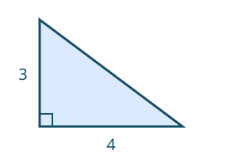

# Прямоугольный треугольник

Два катета перпендикулярны, поэтому один можно принять за основание $a$, а второй за высоту $b$.

{width=5cm}

## Расчёт площади

$$
S = \frac{a b}{2} = \frac{4 \cdot 3}{2} = 6.
$$

| Величина | Значение |
|---|---:|
| Основание | 4 см |
| Высота | 3 см |
| Площадь | 6 см² |
